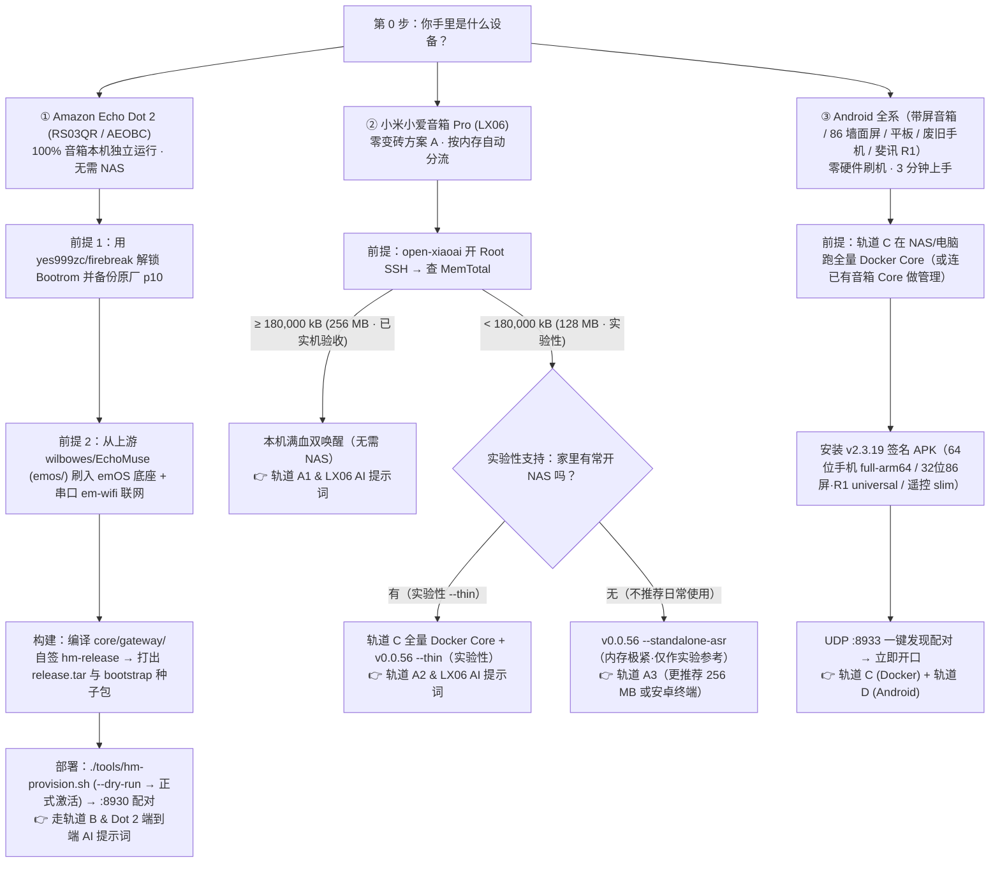

<p align="center">
  
</p>

<p align="center">
  <a href="README.md"><strong>English</strong></a> · <strong>简体中文</strong> · <a href="https://mymate.homes"><strong>官方网站 (mymate.homes)</strong></a>
</p>

<p align="center">
  <a href="https://mymate.homes"></a>
  <a href="LICENSE"></a>
  <a href="LICENSE-PROTOCOL-APACHE-2.0"></a>
  
  
</p>

---

## 这是什么？从「小瑞 · rui」到三层主权家庭语音生态

**Home Mate（中文名：小瑞）** 是开源项目 [小瑞 · rui](https://github.com/yes999zc/rui) 的下一代纯 Rust 全面演进版，现已升级为 **「边缘主权大脑 + 多形态网关彻底隔离 + 家庭主脑 Agent」** 三层架构：

1. **边缘大脑（`hm-core`）：可 100% 跑在音箱本体，也可作为 NAS 全屋中枢**
   - 告别第一代 `rui` 必须依赖常开外部 Python 服务器的限制：在 **Echo Dot 2** 与 **256 MB 小米小爱 Pro（`LX06`）** 上，`hm-core`、Vue 3 控制台（`:8930`）、`hm-gateway` 与离线热词/VAD 引擎（`hm-kws`）**100% 运行在音箱本体**，插电即独立工作。
   - 同一套 `hm-core` 也原生提供 **NAS / 服务器全量 Docker 镜像**（`linux/amd64` + `linux/arm64`，含内置 Silero VAD），统一接入 **128 MB 小内存版 LX06 瘦网关** 与 **全屋安卓终端（带屏音箱、86 墙面屏、平板与废旧手机）**。
2. **主脑 / 家庭 Agent 编排（Master Brain）**
   - 边缘音箱负责毫秒级唤醒、日常快答、音乐/故事/提醒与 Home Assistant 写后回读控家；
   - 复杂长任务、深度多工具检索、家庭汇报与全屋节点巡检（内置 `skills/home-mate-fleet`）通过 `brain.delegate / status / steer / cancel` **异步委派给家庭主脑 Agent**（兼容 Hermes / OpenAI-Compatible Agent 网关）后台执行，绝不阻塞日常语音对话，完成后自动回播到发起房间。
3. **边缘脑 + 多 Gateway 彻底隔离（Northbound Protocol v2）**
   - 单台 `hm-core` 可同时稳定承载多台异构网关接入：
     - **每设备会话与音频完全隔离**：独立上下文、「退下」自动归档历史、统一一键清空当前与归档记录（`DELETE /api/v0/devices/{id}/conversation`）、独立播控与打断路由；
     - **分硬件家族独立 KWS 灵敏度**：Dot2（`0.32 / 2.50`）、LX06（`0.20 / 2.50`）、Android（`0.22 / 3.00`）按硬件类型自动隔离，绝不互相覆盖污染，单设备手动调优优先；
     - **更自然的低延迟交互**：一语直达 `wake_dur_ms` 精准切片、唤醒应答尾音桥接、本地退出词毫秒级打断；安全边界支持家庭 Bearer Token 与局域网私网免密豁免（`lan_gateway_exempt`）。
     - *（透明说明：日常默认采用稳定的半双工模式 + 唤醒词/本地退出词播中打断；**全双工模式仍在持续开发中**，控制台与 Android 客户端均已明确标注「开发中」。）*

> [!IMPORTANT]
> **硬件研究用途声明与自研定制音箱计划**
> 1. **存量音箱仅作技术研究使用**：本项目对**小米小爱音箱 Pro（`LX06`）**与**亚马逊 Echo Dot 2（`RS03QR`）**两款商业音箱的适配代码与部署脚本，**仅作为端侧纯 Rust 语音架构研究、多房间声学仲裁验证与个人非商业实验用途**。相关品牌与型号商标均归原厂商所有，本项目与小米、亚马逊无任何关联，**亦不售卖任何改装版第三方品牌音箱**。
> 2. **正在开发原生定制音箱**：我们正在自主研发**专为 Home Mate · 小瑞 打造的原生定制智能音箱硬件**（开放式远场多麦克风阵列、定制高保真声学腔体、出厂原生搭载主权 Rust 语音系统，无需任何第三方解锁前置步骤），敬请期待。

---

## 正式公开：统一三仓开源生态矩阵（Linux 统一网关 + Android 通用端）

<p align="center">
  
</p>

我们现已正式整合、公开 **Home Mate 三仓完整生态**：

| 仓库 | 定位与核心能力 | 开源协议 |
| :--- | :--- | :--- |
| **[yes999zc/home-mate](https://github.com/yes999zc/home-mate)** *（本仓）* | **边缘大脑与控制台**：`hm-core`（NAS 全量版 & 音箱 `--slim` 精简版）、家庭主脑 Agent 委派、多网关隔离、`hm-release` Ed25519 签名 OTA、Vue 3 控制台（`web/`）、Dot2 配网脚本（`tools/hm-provision.sh`）与北向 v2 协议契约 | `AGPL-3.0`（北向 v2 协议规范 `Apache-2.0`） |
| **[yes999zc/home-mate-gateway-linux](https://github.com/yes999zc/home-mate-gateway-linux)** *（新公开统一 Linux 网关仓）* | **正式合并原 `dot2` 与 `lx06` 分拆仓**：一套特征门控 Rust 代码统一支持 **Echo Dot 2（`board-dot2`）**、**小米 LX06 256 MB**（音箱本体方案 A 双唤醒）与 **小米 LX06 128 MB**（有 NAS 瘦网关 / 无 NAS 本机纯 ASR 尝鲜双方案） | `AGPL-3.0` |
| **[yes999zc/home-mate-gateway-android](https://github.com/yes999zc/home-mate-gateway-android)** *（新公开 Android 通用网关仓）* | **一个自适应零依赖 APK**（Android 5–16），适配**安卓带屏音箱、4 寸 86 墙面控制面板、平板、主力手机，甚至把家里吃灰的废旧安卓手机秒变全屋 AI 语音终端与多房间控制器**，内置离线唤醒与 GitHub Releases 自动更新 | `AGPL-3.0` |

> **旧仓迁移提示**：原独立维护的 `home-mate-gateway-dot2` 与 `home-mate-gateway-lx06` 现已合并至统一的 **[yes999zc/home-mate-gateway-linux](https://github.com/yes999zc/home-mate-gateway-linux)**，后续所有新特性与修复均在统一仓发布。

### 从零到开口对话：设备选型与部署思维导图（新手从这里看！）

设备与模式比较多？顺着下面这张决策导图找到你手里的设备，直接看对应前提、流程与 AI 提示词：



### 我该选择哪种部署组合？（速查表）

| 你手头的设备 | 前置条件 | 推荐架构组合 | 是否需要常开 NAS / 服务器？ | 直达教程 |
| :--- | :--- | :--- | :--- | :--- |
| **亚马逊 Echo Dot 2 (`RS03QR` / `AEOBC`)** | `firebreak` 解锁（备 `p10`）+ 上游 **EchoMuse `emOS`** + `em-wifi` | 音箱本体全量 `hm-core` + `hm-gateway` + `hm-kws`（7 麦 + 160ms AEC + 12 颗灯环） | **不需要**（100% 音箱本体运行） | [轨道 B (Dot 2)](#轨道-b亚马逊-echo-dot-2-rs03qr--aeobc--从原厂到开口对话完整指南) |
| **小米小爱 Pro (`LX06`, 256 MB · 已实机验收)** | `open-xiaoai` 开 Root SSH，`MemTotal ≥ 180,000 kB` | 音箱本体 `hm-core --slim` + `hm-gateway` + `hm-kws`（免刷机双系统） | **不需要**（100% 音箱本体运行） | [轨道 A (LX06)](#轨道-a小米小爱音箱-pro-lx06--256-mb--128-mb-自适应免刷机部署) |
| **小米小爱 Pro (`LX06`, 128 MB · 实验性有 NAS)** | `open-xiaoai` 开 Root SSH + 局域网 NAS 全量 Docker Core | 实验性 **瘦网关**（`--thin`）→ **NAS 全量 Docker `hm-core`** *(维护者暂未在 128 MB 真机验收，请降低预期)* | **需要** | [轨道 A](#轨道-a小米小爱音箱-pro-lx06--256-mb--128-mb-自适应免刷机部署) + [轨道 C](#轨道-cnas--服务器全量-docker-部署128-mb-lx06-与全屋安卓终端中枢) |
| **小米小爱 Pro (`LX06`, 128 MB · 无 NAS 不推荐)** | `open-xiaoai` 开 Root SSH，`/data ≥ 5.5 MiB` | 实验性 **纯 ASR 模式**（`--standalone-asr`）：开机仅剩 ~51 MiB 内存，极易高负载卡顿与唤醒困难 | **不需要** *(不推荐日常折腾)* | [轨道 A (LX06)](#轨道-a小米小爱音箱-pro-lx06--256-mb--128-mb-自适应免刷机部署) |
| **安卓带屏音箱 / 86 屏 / 平板 / 废旧手机 / 斐讯 R1** | Android 5–16（零硬件刷机！） | **NAS / 电脑全量 Docker `hm-core`** + **Android 通用 APK**（`v2.3.19`） | **需要** *(或仅管理模式连音箱 Core)* | [轨道 C](#轨道-cnas--服务器全量-docker-部署128-mb-lx06-与全屋安卓终端中枢) + [轨道 D](#轨道-dandroid-通用终端带屏音箱--86-墙面屏--平板--废旧安卓手机) |

> [!WARNING]
> **关于 128 MB 批次小米 LX06（`MemTotal < 180,000 kB`）的如实说明（请降低预期）**：
> 维护者手头目前只有并长期验收了 **256 MB 批次 LX06**，**所有 128 MB 模式目前均属实验性支持，尚未经过 128 MB 真机压测与验收**。128 MB 批次跑完原厂小爱服务后可用内存仅剩约 **51 MiB**；已有 128 MB 真机社区用户反馈，在保留原厂小爱共存的情况下容易出现 **卡顿、CPU load 严重过载、内存吃紧、唤醒困难（甚至连原厂“小爱同学”都变难唤醒）**。
> - **无 NAS 单机模式（`--standalone-asr`）不推荐日常使用**：`/tmp` 是内存盘，解包 `hm-core`（~13.6 MiB）+ 运行态会把剩余内存压到极限，容易触发闪存反复换页导致卡死；仅保留作实验参考。
> - **有 NAS 瘦网关模式（`--thin`）属实验性**：虽然音箱端内存占用低得多，但当前网关仍与原厂小爱共用麦克风且待机期默认运行实时采音/AEC、缺少本机 KWS，流畅度与唤醒体验仍明显不如 256 MB 批次。
> - **务实建议**：想体验稳定顺滑的 LX06 双唤醒，**强烈建议使用 256 MB 批次**；如果手头只有 128 MB 且不想折腾调优，用闲置安卓手机 / 平板 / 86 墙面屏跑 **Android APK（`v2.3.19`）+ NAS Docker Core** 体验会好得多（已装到 128 MB LX06 随时可执行 `rm -rf /data/hm /data/init.sh && reboot` 一键恢复纯原厂）。

---

## 小米小爱音箱 Pro (`LX06`) 核心亮点（256 MB / 128 MB 自适应）

通过 **[yes999zc/home-mate-gateway-linux](https://github.com/yes999zc/home-mate-gateway-linux)** 部署时，守护进程自动读取 `/proc/meminfo` 的 `MemTotal` 内存容量，自动适配小米出厂的两种硬件批次：

1. **已实机验收的 256 MB 独立全本体 / 实验性 128 MB 双方案**
   - **256 MB 批次（`MemTotal >= 180,000 kB`，主力已验收型号）**：主包（`<= 6.0 MiB`）存放于 `/data/hm`，开机自动解压进 `120.9 MiB` `/tmp` 内存盘，本机独立运行 `hm-core --slim`、`:8930` 控制台、`hm-gateway` 与离线 `hm-kws`（自动采用实机标定的 `0.20 / 2.50` 灵敏度）。
   - **128 MB 小内存批次（`MemTotal < 180,000 kB`，`/tmp` 约 59 MB — 实验性，请降低预期）**：
     - **有 NAS 瘦网关（`--thin`，实验性）**：默认自动进入瘦网关模式（`hm-lx06-thin.tar.xz` 仅 ~607 KB），连接局域网 **NAS / 服务器全量 Docker `hm-core`**。无本机 KWS 且尚未在 128 MB 真机完成负载优化，共存期可能与原厂小爱争抢 CPU 或影响唤醒。
     - **无 NAS 单机纯 ASR（`--standalone-asr`，实验性 / 不推荐日常使用）**：跳过本地 `hm-kws`，在本机跑 `hm-core --slim`（`HM_VOICE_EVENTS=0`）+ `hm-gateway` 走能量 VAD + 云端 ASR 唤醒。因 `/tmp` 占物理内存且原厂小爱后仅剩 ~51 MiB 可用，真机极易内存吃紧、load 过载和唤醒困难，仅作实验尝鲜，不建议当作主力。
2. **不伤害原厂系统（双系统无损共存，零变砖风险）**
   - 原厂只读 SquashFS 分区 `mtd4 / mtd5` **0 字节修改**；随时执行 `rm -rf /data/hm /data/init.sh && reboot` 一键恢复纯原厂小爱。
3. **唤醒词直切双系统（256 MB 双唤醒）**
   - 喊 **“小爱同学”** → 原厂小爱应答（米家蓝牙网关、原厂闹钟照常可用）；
   - 喊 **自定义唤醒词（如“你好高达 / 你好小智”）** → 小瑞 Home Mate 大模型与 Home Assistant 状态回读应答；
   - 说 **“切换小爱”** 或长按播放/暂停键 1.5 秒 → 立即退场交还或切换原厂独占模式。

---

## 实机界面展示：Android 通用端 + Web 控制台

### Android 通用客户端与语音网关（`v2.3.10+` · 4:3 与 1:1 自适应实机截图）

同一个 APK 自动适配手机、废旧手机改造、4 寸 86 墙面屏（`1:1`）及带屏音箱/平板（`4:3`），内置 Sherpa-ONNX JNI 离线唤醒、播中 PBFDAF 回声消除打断、右上角完整对话历史与首页底部字幕条同步一键清空、全屋多房间切控、后台防杀与 GitHub Releases 自动更新：

<table>
  <tr>
    <td width="50%">
      
      <p align="center"><strong>1. 语音主页与统一对话记录清空（手机端 · 4:3）</strong><br>3D 粒子星云球、底部实时字幕条与右上角完整历史面板联动，一键清空当前与归档记录</p>
    </td>
    <td width="50%">
      
      <p align="center"><strong>2. 全屋多房间控播与系统设置（手机端 · 4:3）</strong><br>多核心自由切换、86 墙面屏 Kiosk 桌面常驻、后台防杀管理与 GitHub 自动更新</p>
    </td>
  </tr>
  <tr>
    <td width="50%">
      
      <p align="center"><strong>3. 带屏音箱 / 平板横屏自适应（原生 4:3）</strong><br>自动切换左侧导航栏，适配安卓带屏音箱、桌面支架平板与床头时钟形态</p>
    </td>
    <td width="50%">
      
      <p align="center"><strong>4. 4 寸 86 墙面控制面板自适应（原生 1:1）</strong><br>紧凑方屏排布 + 可选 Kiosk Launcher 常驻，闲置墙面屏一秒接入全屋语音</p>
    </td>
  </tr>
</table>

### 内置 Web 管理控制台（默认浅色主题 · `http://<核心IP>:8930`）

每台音箱或 NAS Docker Core 均在 `:8930` 提供响应式 Vue 3 控制台（支持浅/深主题与中英双语切换）：

<table>
  <tr>
    <td width="50%">
      
      <p align="center"><strong>1. 状态总览 (<code>/status</code>)</strong><br>三大服务就绪检查、设备在线代次、麦克风收音状态与朗读节目进度</p>
    </td>
    <td width="50%">
      
      <p align="center"><strong>2. 唤醒与连续对话 (<code>/interaction</code>)</strong><br>自定义唤醒词、分家族灵敏度、9 秒免唤醒追问窗口与本地退出词</p>
    </td>
  </tr>
  <tr>
    <td width="50%">
      
      <p align="center"><strong>3. 硬件与音频门控 (<code>/devices</code>)</strong><br>硬件状态、房间分组、Silero VAD 门限与播后盲窗</p>
    </td>
    <td width="50%">
      
      <p align="center"><strong>4. 硬件声学均衡曲线 (<code>/devices</code>)</strong><br>LX06 专属 3 段低音防破音 EQ 与 Dot2 专属 EchoMuse 曲线</p>
    </td>
  </tr>
  <tr>
    <td width="50%">
      
      <p align="center"><strong>5. 对话模型、语音服务与家庭主脑 (<code>/services</code>)</strong><br>主备大模型（DeepSeek / GLM）、Qwen3-ASR、火山 TTS 与家庭主脑 Agent 配置</p>
    </td>
    <td width="50%">
      
      <p align="center"><strong>6. Home Assistant 状态回读闭环 (<code>/tools</code>)</strong><br>自动发现暴露实体，每次控家强制写后真实状态回读</p>
    </td>
  </tr>
</table>

---

## 分设备上手向导 & AI 编程助手部署话术（四大轨道）

### 轨道 A：小米小爱音箱 Pro (`LX06`) — 256 MB / 128 MB 自适应免刷机部署

#### 前置条件
1. **确认型号与内存批次**：黑色圆柱款**小米小爱音箱 Pro（底部铭牌 `LX06`，A113X `aarch64`）**，部署前务必通过 SSH 执行 `grep ^MemTotal /proc/meminfo` 区分 **256 MB（`>= 180,000 kB`）** 与 **128 MB（`< 180,000 kB`）**。
2. **自行开启 Root SSH**：参考社区项目 [idootop/open-xiaoai](https://github.com/idootop/open-xiaoai) 开启 22 端口 SSH 登录。
3. **如为 128 MB 批次**：有 NAS/电脑优先按下方 **轨道 C** 部署**全量 Docker `hm-core`** 配合 `--thin` 瘦网关；如**无 NAS**，可直接选用 `--standalone-asr` 单机纯 ASR 尝鲜模式（`v0.0.54+` Release 已提供免编译预编译包）。

#### 手工命令（`v0.0.54+` 支持免 Rust 编译直接下载成品包）
```bash
git clone https://github.com/yes999zc/home-mate-gateway-linux.git
cd home-mate-gateway-linux

# 情况 A1：256 MB 批次（100% 音箱本体双唤醒）
./tools/pack_lx06_bundle.sh
python3 -m http.server 18089 --directory build/lx06 &
./deploy/lx06/install-lx06.sh --device-ip 192.168.1.50 --kws-url http://192.168.1.10:18089/hm-kws-lx06.tar.xz

# 情况 A2：128 MB 小内存批次 + 有 NAS（推荐，免编译下载瘦网关包直连 NAS 全量 Docker Core）
mkdir -p build/lx06 && for f in hm-lx06-thin.tar.xz hm-lx06-thin.sha256 init.sh unxz SHA256SUMS.txt; do
  curl -fL "https://github.com/yes999zc/home-mate-gateway-linux/releases/download/v0.0.56/$f" -o "build/lx06/$f"
done && chmod +x build/lx06/init.sh build/lx06/unxz
./deploy/lx06/install-lx06.sh --thin --device-ip 192.168.1.50 --core-addr 192.168.1.10:8932 --device-id lx06-living --core-token "<TOKEN>"

# 情况 A3：128 MB 小内存批次 + 无 NAS（单机纯 ASR 尝鲜，免编译下载主包，不跑本地 KWS）
mkdir -p build/lx06 && for f in hm-bundle.tar.xz hm-bundle.sha256 init.sh unxz SHA256SUMS.txt; do
  curl -fL "https://github.com/yes999zc/home-mate-gateway-linux/releases/download/v0.0.56/$f" -o "build/lx06/$f"
done && chmod +x build/lx06/init.sh build/lx06/unxz
./deploy/lx06/install-lx06.sh --standalone-asr --device-ip 192.168.1.50 --device-id lx06-standalone
```

#### 让 AI 编程助手一键自适应部署 LX06（自动判断 256 MB / 128 MB 三模式）
复制以下话术给 **Claude Code / Cursor / Codex / Antigravity**（**请先将示例 IP `192.168.1.50` 和 `192.168.1.10` 替换为你家真实局域网 IP；如果没有 NAS 可注明“无 NAS”**）：
```text
请帮我将 Home Mate · 小瑞部署到我的小米小爱音箱 Pro（型号 LX06，已通过 open-xiaoai 开启 root SSH）：
【请先替换下方示例 IP 为你的真实局域网 IP】
- 音箱 SSH 地址：root@192.168.1.50
- 局域网 NAS / 电脑 IP：192.168.1.10（如果我没有常开 NAS，请改走 128 MB 无 NAS 单机纯 ASR 模式）

请严格遵守以下安全与自适应步骤：
1. 严禁修改原厂只读 SquashFS 分区（mtd4 / mtd5），仅使用方案 A（/data/hm 与 /data/init.sh）。
2. 克隆 https://github.com/yes999zc/home-mate-gateway-linux.git（如部署 256 MB 自行编译或 NAS Docker，请平级克隆 https://github.com/yes999zc/home-mate.git）。
3. SSH 登录 root@<音箱IP> 检查 `uname -m`、`grep ^MemTotal /proc/meminfo` 与 `df -k /data /tmp`，根据实测内存自动分流：
   - 若 MemTotal >= 180000 kB（256 MB 批次 → 音箱本体双唤醒）：
     a) 确认 /data 剩余 >= 6000 KB，执行 `./tools/pack_lx06_bundle.sh` 打包，并用 HTTP 在 <托管机IP>:18089 托管 build/lx06/（验证 hm-kws-lx06.tar.xz 返回 200）。
     b) 执行 `./deploy/lx06/install-lx06.sh --device-ip <音箱IP> --kws-url http://<托管机IP>:18089/hm-kws-lx06.tar.xz`。
     c) 验证音箱 `hm-core`、`hm-gateway`、`hm-kws` 运行正常、`http://<音箱IP>:8930` 返回 200、`/api/v0/mode` 中 LX06 灵敏度为 `0.20 / 2.50`。
   - 若 MemTotal < 180000 kB（128 MB 批次，可直接从 `home-mate-gateway-linux` 最新 Release `v0.0.54+` 下载免编译成品包到 `build/lx06/` 并校验 `SHA256SUMS.txt`）：
     * 【优先·有 NAS → 瘦网关模式】：
       a) 先在 NAS（<托管机IP>）部署 `yes999zc/home-mate` 的**标准全量版 Docker `hm-core`**（不要用 `--slim`，开启 `HM_GATEWAY_ALLOW_LAN=1` 并配对管理员令牌）。
       b) 下载 `hm-lx06-thin.tar.xz`、`hm-lx06-thin.sha256`、`init.sh`、`unxz`，执行 `./deploy/lx06/install-lx06.sh --thin --device-ip <音箱IP> --core-addr <托管机IP>:8932 --core-token "<令牌>"`。
       c) 验证音箱上**只运行 `hm-gateway`** 且在 `http://<托管机IP>:8930` 显示在线。
     * 【无 NAS 尝鲜 → 本机纯 ASR 模式】：
       a) 确认 /data 剩余 >= 5500 KB，下载 `hm-bundle.tar.xz`、`hm-bundle.sha256`、`init.sh`、`unxz`。
       b) 执行 `./deploy/lx06/install-lx06.sh --standalone-asr --device-ip <音箱IP>`。
       c) 验证音箱仅运行 `hm-core`（含 `HM_VOICE_EVENTS=0`）与 `hm-gateway`（无 `hm-kws`）、`/tmp` 占用 < 45%、且 `http://<音箱IP>:8930` 返回 200。
     * 【可选进阶（128 MB 无 KWS 模式下“喊小爱同学打断放歌”）】：默认版本为保 256 MB 稳定会在小瑞放歌时暂停原厂 `pns`；若我希望无 KWS 模式下喊“小爱同学”即可直接打断小瑞播放，可帮我在 `home-mate-gateway-linux` 的 `crates/gateway/src/firmware/lx06_vendor.rs`（`wants_pns` 的 `!local_kws_enabled` 分支及 `instruction.log` 原厂唤醒触发停播）做本地定制并用 `./tools/build_firmware_lx06.sh` 重编。
4. 严禁将任何真实 IP、Token 或密钥提交到 Git；生成的家庭令牌请保存至 `~/.home-mate/`（权限 0600）。
```

---

### 轨道 B：亚马逊 Echo Dot 2 (`RS03QR` / `AEOBC`) — 从原厂到开口对话完整指南

#### 前置三步（`emOS` 到底从哪里来？）
Home Mate 在 Echo Dot 2 上 **100% 本机独立运行**，底层依托的是上游开源项目 **[`wilbowes/EchoMuse`](https://github.com/wilbowes/EchoMuse)** 打造的 **`emOS`** 轻量 Linux 系统层——它完整保留了 Dot 2 原厂的 MediaTek 3.18 内核与 7 麦/3.5mm 音频驱动，同时彻底剥离了臃肿的亚马逊 FireOS/Android 用户态。

1. **步骤 0 — 通过 `firebreak` (`amonet`) 解锁 Bootrom**：
   - **切记：原厂未解锁的 Echo Dot 2 解锁前切勿在 Alexa App 里联网升级高版本固件！**
   - 用 Micro-USB 数据线连接电脑，按 **[`yes999zc/firebreak`](https://github.com/yes999zc/firebreak)** 执行 `uvx firebreak@latest` 完成一次性 Bootrom 解锁，并**妥善留存备份下来的原厂 `p10` 分区镜像**。
2. **步骤 1 — 从上游 `wilbowes/EchoMuse` 刷入 `emOS` 音频底座**：
   - 克隆上游 **[`wilbowes/EchoMuse`](https://github.com/wilbowes/EchoMuse)**，按照仓库根目录 **[`SETUP.md`](https://github.com/wilbowes/EchoMuse/blob/main/SETUP.md)** 与 **[`emos/`](https://github.com/wilbowes/EchoMuse/tree/main/emos)** 的向导（`emos-v0.10+`），用你这台音箱自己的原厂内核/DTB 打包并刷入 **`emOS`**。*（`emOS` 并非单行道，在串口执行 `/init recovery` 随时可退回 TWRP。）*
3. **步骤 2 — USB 串口执行 `em-wifi` 连上家庭 Wi-Fi**：
   - 用 Micro-USB 线连上电脑，打开串口控制台（macOS 为 `/dev/cu.usbmodem*`，Linux 为 `/dev/ttyACM*`），确认 `cat /etc/os-release` 返回 `ID=emos`，执行 **`em-wifi`** 选好家里 Wi-Fi 并记下分配到的局域网 IP。

#### 步骤 3 — 首次构建、生成自签名 Release 包与 Bootstrap 种子包
> **宿主机交叉编译前置依赖（macOS / Linux 均支持）**：Rust（`rustup target add aarch64-unknown-linux-musl armv7-unknown-linux-musleabihf` 与 `rustup component add llvm-tools` / `rust-lld`）、`zig` + `cargo-zigbuild`、Node.js 20+、Python 3 + `pyserial`，以及通过 `home-mate-gateway-linux/kws/build.sh` + `kws/assemble.sh` 准备好的 Sherpa-ONNX aarch64 KWS 侧车包（`~/.home-mate/kws-build/bundle`）。

将两个仓库克隆到**平级目录**（`hm-provision.sh` 与 `build_bootstrap.py` 会自动探测同级的 `../home-mate-gateway-linux`）：
```bash
git clone https://github.com/yes999zc/home-mate.git
git clone https://github.com/yes999zc/home-mate-gateway-linux.git
cd home-mate

# 1. 生成你自己的 Ed25519 签名密钥对（存于 Git 之外），并将你的公钥编入 hm-release：
cargo build -p hm-release
./target/debug/hm-release keygen --out ~/.home-mate/signing/release-signing-key.hex
./target/debug/hm-release pubkey --key ~/.home-mate/signing/release-signing-key.hex > deploy/release/release-pubkey.hex
./tools/build_release.sh             # 编译内置你公钥的 aarch64 静态 hm-release
cargo build -p hm-release            # 同步更新宿主机验签工具

# 2. 编译全量 hm-core (aarch64)、Vue 3 控制台与 Dot 2 网关 (armv7，切勿直接手打裸 cargo zigbuild！)：
./tools/build_core.sh
(cd web && npm install && npm run build)
(cd ../home-mate-gateway-linux && ./tools/build_firmware.sh)

# 3. 组装并签名 home-mate-release.tar（完整细则见 deploy/release/README.md）：
VER=$(date +%Y.%m.%d)-1
REL="build/release-$VER"
mkdir -p "$REL/components/model"
cp target/aarch64-unknown-linux-musl/release/hm-core "$REL/components/core-aarch64"
cp ../home-mate-gateway-linux/target/armv7-unknown-linux-musleabihf/release/home-mate-device-gateway "$REL/components/firmware-armv7"
cp -a web/dist "$REL/components/web"
# 下载经过 SHA-256 锁定审计的 Silero VAD v4 16 kHz 模型（643,854 B）：
curl -fL https://github.com/k2-fsa/sherpa-onnx/releases/download/asr-models/silero_vad.onnx \
  -o "$REL/components/model/silero_vad.onnx"
./target/debug/hm-release pack --dir "$REL" --out "build/release/home-mate-release-$VER" \
  --serial 1 --version "$VER" --key ~/.home-mate/signing/release-signing-key.hex \
  --model AEOBC --profile dot2d-emos --firmware-min 0.0.44 --firmware-max 0.0.99

# 4. 生成单机 bootstrap 种子包（需准备好 ~/.home-mate/kws-build/bundle 下的 Sherpa-ONNX KWS 侧车；
#    家里第一台全新 Dot 2 尚未配 TTS 时，附加 --allow-empty-wake-acks）：
python3 tools/build_bootstrap.py \
  --device-id dot2-living \
  --release "build/release/home-mate-release-$VER.tar" \
  --allow-empty-wake-acks
```

#### 步骤 4 — 一键串口刷入与激活（`tools/hm-provision.sh`）
```bash
# 1. 只读预检（不写入设备任何字节）：
./tools/hm-provision.sh --device-id dot2-living \
  --seed "build/bootstrap/home-mate-bootstrap-dot2-living-$VER.tar.gz" \
  --release "build/release/home-mate-release-$VER.tar" \
  --serial /dev/cu.usbmodem8401 --ip 192.168.1.73 \
  --wake-word 你好小智 --dry-run

# 2. 去掉 --dry-run 正式执行安装、Ed25519 签名激活（健康自检）与令牌配对：
./tools/hm-provision.sh --device-id dot2-living \
  --seed "build/bootstrap/home-mate-bootstrap-dot2-living-$VER.tar.gz" \
  --release "build/release/home-mate-release-$VER.tar" \
  --serial /dev/cu.usbmodem8401 --ip 192.168.1.73 \
  --wake-word 你好小智
```
*（完成后打开 `http://<Dot2_IP>:8930` 填入 LLM / ASR / TTS 与 Home Assistant，`hm-core` 会在保存 TTS 后自动合成唤醒应答音；多台 Dot 2 声学参数请单台独立标定，切勿跨机复制。）*

#### 让 AI 编程助手端到端代你完成 Echo Dot 2 部署（从原厂解锁 / emOS 到开口对话）
```text
请帮我将 Home Mate 部署到我的亚马逊 Echo Dot 2（第二代，型号 RS03QR / AEOBC）：
【请先替换下方示例信息为你的实际情况】
- 当前音箱状态：<原厂未解锁 / 已用 firebreak 解锁 / 已刷好 emOS 并联网>
- USB 串口设备：/dev/cu.usbmodem8401（或让 AI 执行 `ls /dev/cu.usbmodem* /dev/ttyACM*` 自动查找）
- 音箱局域网 IP：192.168.1.73（emOS 执行 em-wifi 后获得的 IP）
- 期望节点 ID 与唤醒词：dot2-living / 你好小智（可按需改为任意中/英文唤醒词）
- （可选）家里已配好的参考节点 IP：无

请严格按以下全流程安全执行：
1. 前置检查（需人工交互确认，严禁未经我允许自动刷写 p10）：
   - 若尚未解锁：先引导我用 `https://github.com/yes999zc/firebreak`（`uvx firebreak@latest`）通过 Micro-USB 解锁 Bootrom，并妥善保存原厂 `p10` 备份。
   - 若尚未刷入 emOS：引导我克隆上游 `https://github.com/wilbowes/EchoMuse`，按其 `emos/` 目录向导（`emos-v0.10+`）用本机内核刷入 emOS 底座，并在 USB 串口运行 `em-wifi` 联网，直到 `cat /etc/os-release` 返回 `ID=emos` 且拿到局域网 IP。
2. 将 `https://github.com/yes999zc/home-mate.git` 与 `https://github.com/yes999zc/home-mate-gateway-linux.git` 克隆到平级目录（`hm-provision.sh` 与 `build_bootstrap.py` 会自动探测同级的 `../home-mate-gateway-linux`）。
3. 构建与自签名打包（参考 `deploy/release/README.md`）：
   - 在 Git 之外生成我自己的 Ed25519 密钥 `~/.home-mate/signing/release-signing-key.hex`（chmod 600），将公钥写入 `deploy/release/release-pubkey.hex` 后编译 `hm-release`（`./tools/build_release.sh` + `cargo build -p hm-release`）。
   - 编译全量 `hm-core`（`./tools/build_core.sh`）、前端 `web/dist`，以及在 `home-mate-gateway-linux` 里用 `./tools/build_firmware.sh` 编译 Dot 2 网关（严禁直接跑裸 `cargo zigbuild`！）。
   - 用 `hm-release pack` 打出签名 `home-mate-release.tar`，准备好 `~/.home-mate/kws-build/bundle` 侧车包后，运行 `python3 tools/build_bootstrap.py --device-id dot2-living --release <tar> --allow-empty-wake-acks` 生成种子包。
4. 串口安全部署：
   - 先加 `--dry-run` 预检 `./tools/hm-provision.sh`，向我展示串口 `ID=emos`、`/data/emos/sockets` 与将要执行的操作。
   - 经我确认后去掉 `--dry-run` 正式刷入激活，验证健康自检、将令牌保存至 `~/.home-mate/dot2-living.token`（chmod 600），并确认 `http://<音箱IP>:8930` 返回 HTTP 200。
5. 严禁将任何真实 IP、Token 或签名私钥提交到 Git；切勿跨机复制其他 Dot 2 的声学标定参数。
```

---

### 轨道 C：NAS / 服务器全量 Docker 部署（128 MB LX06 与全屋安卓终端中枢）

支持群晖、飞牛 fnOS、绿联、Unraid、树莓派与 Linux/macOS 服务器（`linux/amd64` + `linux/arm64` 多架构镜像），**镜像已开箱内置 Silero VAD v4 神经端点检测**，务必部署标准全量版（切勿在 NAS 使用 LX06 专用 `--slim`）：

```bash
# Linux NAS / 服务器请先赋予 ./data 容器 UID 1000:1001 权限，并使用 --network host
# 确保局域网 UDP :8933 一键发现与真实内网来源 IP 透传正常工作：
mkdir -p ./data && sudo chown -R 1000:1001 ./data
docker run -d \
  --name home-mate-core \
  --restart unless-stopped \
  --network host \
  -e TZ=Asia/Shanghai \
  -e HM_GATEWAY_ALLOW_LAN=1 \
  -v "$(pwd)/data:/data" \
  ghcr.io/yes999zc/home-mate:latest
```
*（macOS Docker Desktop 用户可将 `--network host` 替换为 `-p 8930:8930 -p 8932:8932 -p 8933:8933/udp`；也可直接下载 Release 附件 `docker-compose.yml` 执行 `docker compose up -d`，默认直拉 GHCR 镜像零编译。首次启动后请立即访问 `http://<NAS_IP>:8930` 配对家庭管理员令牌。）*

#### 让 AI 编程助手一键部署 NAS 全量 Core 与家庭主脑
```text
请帮我在局域网 NAS/服务器（192.168.1.10）上部署 https://github.com/yes999zc/home-mate 的标准全量版 Docker `hm-core`：
1. 使用标准全量镜像（切勿使用 `--slim`），开启 `HM_GATEWAY_ALLOW_LAN=1`，持久化挂载 `./data:/data`，并开放 8930/tcp（Web 控制台）、8932/tcp（北向 v2 多网关接入）与 8933/udp（局域网一键发现）。
2. 验证 `http://192.168.1.10:8930/` 返回 200 且 `/api/v0/status` 健康。
3. 立即调用 `/api/v0/auth/provision` 生成家庭管理员令牌并保存到本机 `~/.home-mate/nas.token`（chmod 600），再引导我配置 LLM/ASR/TTS、可选家庭主脑（`master_brain`）及是否启用局域网可信设备免密豁免（`lan_gateway_exempt`）。
```

---

### 轨道 D：Android 通用终端（带屏音箱 / 86 墙面屏 / 平板 / 废旧安卓手机）

零刷机、3 分钟把安卓带屏音箱、4 寸 86 墙面控制面板、平板、主力机或吃灰的废旧安卓手机变成 **Home Mate 远场语音终端 + 全屋中控**：

1. **按机型挑选 APK**（前往 **[yes999zc/home-mate-gateway-android](https://github.com/yes999zc/home-mate-gateway-android/releases)** 下载）：
   - **`full-arm64`（~13 MB）**：**现代 64 位手机/平板首选**，含完整离线语音唤醒（Sherpa-ONNX JNI）。
   - **`universal`（~21 MB）**：同时内置 **64 位 + 32 位** 离线唤醒库，**32 位 86 墙面屏 / 老旧平板 / 不确定架构时直接选它**。
   - **`slim`（~225 KB）**：超轻量纯控端，不含本地离线唤醒库（适合纯全屋遥控、文字对话与点击语音）。
2. **连接 Core**：打开 APP 点击 **「扫描局域网」**（UDP `:8933` 自动发现）或手动输入 `<Core_IP>:8930` 与家庭令牌，即可语音互动并控制全屋房间。
3. **自动更新**：默认直连 **GitHub Releases** 按 CPU 架构自动匹配对应安装包（同时支持自定义局域网 `version.json` 更新源）。

#### 让 AI 编程助手协助配置或本地编译 Android 端
```text
请帮我把 Home Mate Android 通用端（https://github.com/yes999zc/home-mate-gateway-android）接入到我局域网 192.168.1.10 的 Home Mate Core：
1. 检查 `http://192.168.1.10:8930/api/v0/auth`、确认 Core 已开启 `HM_GATEWAY_ALLOW_LAN=1` 监听 `:8932` 且开放 UDP `:8933` 发现广播。
2. 按我的设备形态推荐对应 APK（64 位手机选 `full-arm64`，32 位 86 墙面屏/老平板选 `universal`，仅遥控选 `slim`）。
3. 若需要从源码本地编译，请执行 `./tools/test_jvm.sh` 与 `./tools/build_apk.sh`（对外发布时请务必配置独立正式签名 Keystore 环境变量，不要使用调试口令证书）。
```

---

## 首次控制台配置：LLM / ASR / TTS 与唤醒词速查

音箱或 NAS Core 启动后，访问 `http://<Core_IP>:8930` 进入 **「服务 / Services」** 页面配齐三项服务（尤其是 **128 MB LX06 `--thin` / `--standalone-asr`** 模式不跑本地 `hm-kws`，唤醒完全依赖 **VAD → ASR 识别文字 → 匹配唤醒词**，必须先配通 ASR 才能唤醒）：

| 服务卡片 | 允许填写的 `provider` 值 | `base_url` 填写规则（避免 `http 404`） | 可直接照抄示例 |
| :--- | :--- | :--- | :--- |
| **语音识别（ASR）** | **`openai-asr`**（支持任意 OpenAI 兼容 `/v1/audio/transcriptions` 接口）或 `mock` | **必须以 `/v1` 结尾**——后端自动拼接 `/audio/transcriptions`（切勿漏 `/v1`，也不要重复粘 `/audio/transcriptions`） | `provider`：`openai-asr`<br/>`base_url`：`https://api.siliconflow.cn/v1`（硅基流动国内直连；或 OpenAI `https://api.openai.com/v1` / Groq / 本地 oMLX `http://<IP>:<端口>/v1`）<br/>`model`：`FunAudioLLM/SenseVoiceSmall`（或 `whisper-1`） |
| **语音合成（TTS）** | **`volc`**（火山引擎 / 豆包 `seed-tts-2.0`，中文推荐）<br/>**`omni`**（任意 OpenAI 兼容 `/v1/audio/speech` 且支持返回 WAV 的接口，兼容别名 `openai_compat`）<br/>或 `mock` | - 选 `volc`：`base_url` 与 `model` **可留空**（自动用官方 `seed-tts-2.0` 地址）<br/>- 选 `omni`：**必须以 `/v1` 结尾**（后端自动拼 `/audio/speech`） | **火山豆包**：`provider`：`volc`，`base_url`/`model` 留空，`voice`：`zh_female_xiaohe_uranus_bigtts`，`API 密钥` 填火山 `X-Api-Key`<br/>**OpenAI 兼容**：`provider`：`omni`，`base_url`：`https://api.siliconflow.cn/v1`（或 `https://api.openai.com/v1`），`model`：`FunAudioLLM/CosyVoice2-0.5B`（或 `tts-1`），`voice`：`FunAudioLLM/CosyVoice2-0.5B:alex`（或 `alloy`） |
| **对话模型（LLM）** | 任意 OpenAI 兼容标识（如 `deepseek` / `openai` / `siliconflow` / `ollama`） | 填写接口根地址（通常以 `/v1` 结尾），不要重复填写 `/chat/completions` | `provider`：`deepseek`，`base_url`：`https://api.deepseek.com/v1`，`model`：`deepseek-chat` |

> **默认唤醒词与验证步骤**：
> 1. 在每张卡片填写完毕后依次点 **「保存」→「测试连接」**，确认三项全部出现绿色 `✓`。
> 2. 进入左侧 **「交互 / Interaction」** 页面查看或自定义唤醒词（全新默认唤醒词为 **`你好高达`**，可改为 `你好小智` 等）。
> 3. 在 **「状态 / Status」** 或 **「设备 / Devices」** 页确认音箱网关在线，对着音箱说出唤醒词即可开始对话！

---

## 致谢

感谢所有让 Home Mate 成为可能的开源项目与硬件社区（完整许可见 [THIRD_PARTY_NOTICES.md](THIRD_PARTY_NOTICES.md)）：

- **音箱与网关管线**：[idootop/open-xiaoai](https://github.com/idootop/open-xiaoai) & [@coderzc/open-xiaoai](https://github.com/coderzc/open-xiaoai)（MIT）、[k2-fsa/sherpa-onnx](https://github.com/k2-fsa/sherpa-onnx)（Apache-2.0）、[Microsoft ONNX Runtime](https://onnxruntime.ai/)（MIT）、[snakers4/silero-vad](https://github.com/snakers4/silero-vad)（MIT）、[xiph/speexdsp](https://github.com/xiph/speexdsp)（BSD-3-Clause）、[pdeljanov/Symphonia](https://github.com/pdeljanov/Symphonia)（MPL-2.0）、Tokio、Axum、Rusqlite、RustCrypto、Vue 3 与 Lucide。
- **社区贡献致谢**：特别感谢 **[@jiantongzh](https://github.com/jiantongzh)** 实机验证 128 MB 批次 LX06 并贡献瘦网关方案思路。
- **架构渊源与参考**：[yes999zc/rui（小瑞）](https://github.com/yes999zc/rui)、[wilbowes/EchoMuse](https://github.com/wilbowes/EchoMuse)、[Rhasspy](https://github.com/rhasspy/rhasspy) / [Wyoming](https://github.com/rhasspy/wyoming)、[Home Assistant](https://github.com/home-assistant/core) 与 [Navidrome](https://github.com/navidrome/navidrome)。

---

## 开源协议与联系方式

- **开源协议**：遵循 **[GNU AGPL v3.0（`AGPL-3.0-only`）](LICENSE)** 开源；北向 v2 网关通信协议规范（`crates/hm-core/src/gateway/`）额外遵循 **[Apache-2.0](LICENSE-PROTOCOL-APACHE-2.0)**（详见 [`LICENSING.md`](LICENSING.md)）。
- **官方网站**：**[https://mymate.homes](https://mymate.homes)**
- **联系作者（自研定制音箱合作 / 商业 OEM 授权）**：**`zhangcong1985@gmail.com`** / **`yes999zc@163.com`**
